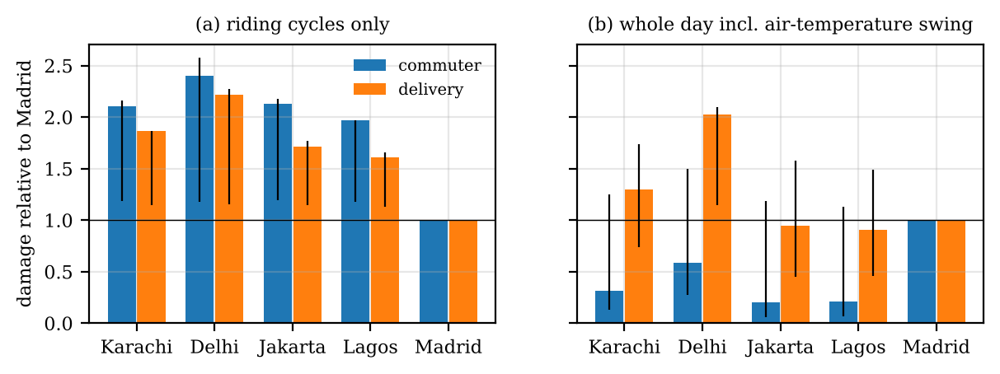

# Climate or design? Thermal cycling of e-scooter motor controllers in five cities

**The question.** Most electric two-wheelers are sold in hot countries, and
their motor controllers are built from cheap discrete MOSFETs. How much does a
hot climate add to the thermal cycling that wears these parts out, and how
does that compare with design and use choices such as cooling, MOSFET count
or carrying a passenger?

**What is done here.** A 2 kW, 72 V scooter (102 kg, 70 km/h) drives the
WMTC test cycle with the official road load of UN GTR No. 2. Inverter losses
come from the Infineon IRFB4115 datasheet, and a heatsink model gives the
junction temperature every second for all of 2025, using NASA POWER weather
for Karachi, Delhi, Jakarta, Lagos and Madrid, for a commuter and a delivery
rider. Cycles are counted with rainflow (ASTM E1049) and weighted with a
Coffin-Manson-Arrhenius law anchored to the part's own qualification test.

**Report (IEEE format):** [`report/Gillani_E2W_Controller_Climate.pdf`](report/Gillani_E2W_Controller_Climate.pdf)



## Main results

| | Karachi | Delhi | Jakarta | Lagos | Madrid |
|---|---|---|---|---|---|
| hours above 35 °C in 2025 | 173 | 956 | 0 | 0 | 212 |
| max junction temp, delivery, base (°C) | 52.5 | 58.2 | 43.4 | 43.7 | 52.6 |
| damage vs Madrid, delivery (riding cycles) | 1.86 | 2.22 | 1.71 | 1.61 | 1.00 |

- **Climate adds about 1.1 to 2.6 times** the riding-cycle damage of Madrid
  over 36 life-model settings. Delhi is worst in 63 of 72 cases. Most of the
  spread comes from the assumed activation energy; with none, the hot cities
  are only 1.13 to 1.50 times Madrid.
- **Design and use matter more.** For the delivery rider in Delhi: no
  airflow around the box ×17.0, 12 instead of 18 MOSFETs ×9.2, a 150 A /
  4.5 kW tune ×5.8, slow gate drive ×3.9, a passenger ×2.8, 8 K of body heat
  ×2.1.
- **Counting method can flip the ranking.** If the slow day-long swing of the
  air temperature is counted as a cycle, the commuter in dry Madrid becomes
  the worst case (30 of 36 settings), because 97 % of that damage comes from
  the morning-to-evening swing. Power-cycling laws were not fitted for such
  slow cycles, so the per-ride counting is the main result.
- **Absolute wear-out is small.** Even in a hard-use case (no airflow,
  12 MOSFETs, +8 K, +75 kg) the yearly damage is at most about 2.3 % of the
  qualification test's cycling. The hot-climate risk shows up as heat
  instead: in that case the heatsink exceeds 80 °C for 13.5 riding hours a
  year in Delhi (almost all in April to June), 1.0 in Madrid, and never in
  Jakarta or Lagos.

## Code

| File | What it does |
|---|---|
| `src/wmtc.py` | reads the WMTC tables from the GTR No. 2 PDF into `data/wmtc.csv` |
| `src/vehicle.py` | scooter model, GTR Annex 3 road load, controller limits, phase current |
| `src/mosfet.py` | IRFB4115 conduction, switching and recovery losses (datasheet values) |
| `src/weather.py` | NASA POWER loader, LST to local clock |
| `src/mission.py` | use profiles and the second-by-second heatsink and junction model |
| `src/rainflow.py` | ASTM E1049 three-point rainflow counting |
| `src/damage.py` | damage index anchored to the qualification test, stress metrics |
| `src/run_all.py` | the full study, figures and `results/` |
| `tests/` | checks for rainflow, road load, energy, data completeness |

```bash
pip install -r requirements.txt
cd src
python run_all.py            # about 2 minutes; writes figures/ and results/
python ../tests/test_rainflow.py && python ../tests/test_models.py
```

`results/summary.txt` has every number quoted in the report.

## Data and sources

- `data/nasa/`: NASA POWER hourly files for 2025 (T2M, MERRA-2 based).
- `data/wmtc.csv`: WMTC parts 1 to 3, extracted from UN GTR No. 2
  (ECE/TRANS/180/Add.2, Annex 5). The PDF is not redistributed; run
  `python wmtc.py GTR-No-2.pdf` to rebuild the file from it.
- Infineon IRFB4115PbF datasheet (Rev. 2.1) and product qualification report
  (Rev. 1.0): values are quoted in `src/mosfet.py` and `src/damage.py`; the
  PDFs are not redistributed.

## Limitations

- No measurement of a real controller. The box thermal resistance and mass,
  controller limits, body-heat offset and use profiles are assumptions, which
  is why they are varied.
- The GTR road-load table was written for conventional motorcycles; WMTC has
  no hills and may be milder than city traffic.
- The life law was fitted for IGBT modules and is extrapolated to small
  cycles, so the damage index ranks cases and is not a lifetime.
- Air temperature is used as the ambient; one year of weather only.

## About

Syeda Tehreem Gillani, FAST-NUCES Karachi. AI-based coding assistance was used
for parts of the software and the first draft of the text; modelling choices,
results and text were checked by me. License: MIT.
